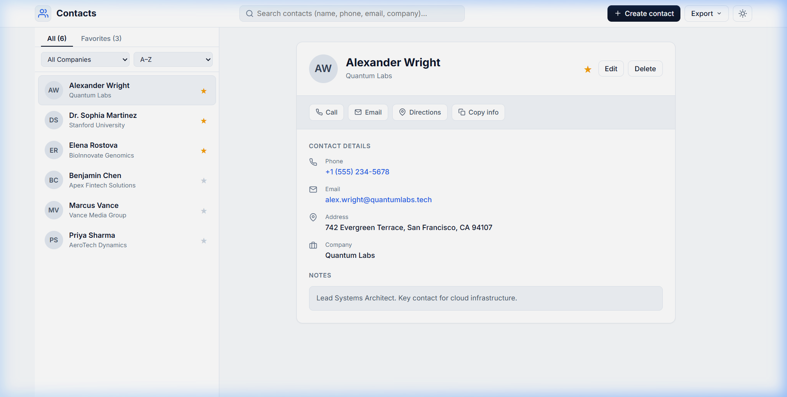

# 📇 Contact Book

A modern, full-featured **Contact Book web application** built with Python Flask and a clean, responsive UI.

## 📸 Screenshot



---

## ✨ Features

- 📋 View, add, edit and delete contacts
- ⭐ Mark contacts as favourites
- 🔍 Search contacts by name, phone, email or company
- 🏢 Filter by organisation / company
- 🔃 Sort contacts A–Z or Z–A
- 📤 Export contacts as **CSV** or **VCF (vCard)**
- 🌙 Dark mode support
- 📱 Responsive design

---

## 🚀 Quick Start

### Step 1 — Clone the repository
```bash
git clone https://github.com/omik-kashyap/other-s-project.git
cd other-s-project
```

### Step 2 — Create a virtual environment
```bash
python -m venv .venv
```

### Step 3 — Install dependencies
```bash
# Windows
.venv\Scripts\pip install -r requirements.txt

# Mac / Linux
.venv/bin/pip install -r requirements.txt
```

### Step 4 — Run the app
```bash
# Windows
.venv\Scripts\python contact_book\app.py

# Mac / Linux
.venv/bin/python contact_book/app.py
```

### Step 5 — Open in browser
```
http://127.0.0.1:5002
```

> 💡 **Tip:** Steps 1–3 are only needed **once**. After that, just run Step 4 & 5 every time.

---

## 🛠️ Tech Stack

| Technology | Purpose |
|---|---|
| Python 3 | Backend language |
| Flask | Web framework |
| SQLite | Database (auto-created) |
| HTML / CSS / JS | Frontend UI |

---

## 📁 Project Structure

```
contact_book/
├── app.py          # Flask app & API routes
├── database.py     # SQLite database logic
├── cli.py          # Command-line interface
├── templates/
│   └── index.html  # Main HTML page
└── static/
    ├── css/        # Stylesheets
    └── js/         # Frontend JavaScript
```

---

## 📬 Contact

Made with ❤️ — feel free to fork, use and share!
